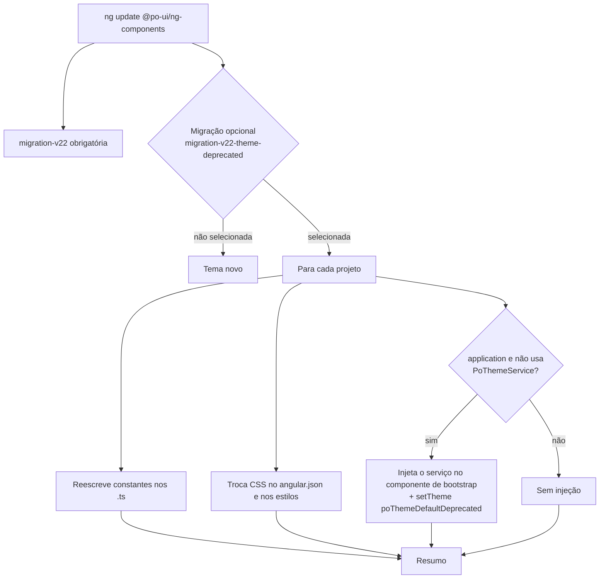

# Especificação: migração opcional para o tema padrão depreciado (v22)

- **Branch:** `themes/evo-22.x.x`
- **Pacote:** `@po-ui/ng-components` (schematics em `projects/ui/schematics`)
- **Status:** implementado (pendente: demo da Task 6 no verdaccio e itens para confirmar)

## Problema

A v22 troca o tema padrão do PO UI. As cores novas vêm do `poThemeDefault` e do arquivo
`po-theme-default.min.css` do `@po-ui/style`. As bordas novas vêm do CSS base que o `PoThemeService`
aplica (`poThemeSharedBase`). O tema anterior continua disponível, isolado em
`projects/ui/src/lib/services/po-theme/helpers/deprecated/` e em `po-theme-default-deprecated*.css`,
até sua remoção na v24.

Durante o `ng update` para a v22, o desenvolvedor precisa poder escolher voltar ao tema anterior. Para
isso, a migração reaponta o código e os estilos do projeto para os artefatos depreciados. A
recomendação oficial continua sendo o tema novo, e a migração não deve incentivar o uso do depreciado.

## Requisitos

1. A migração é **opcional** no `ng update` e vem **desmarcada** (`recommended: false`). O texto
   apresentado explica que a v22 traz uma nova experiência padrão, que recomendamos usá-la e que o
   tema anterior fica depreciado até ser removido na v24.
2. Não divulgamos como executar a migração depois do `ng update`. A migração obrigatória
   `migration-v22`, o guia `theme-service.md` e o `schematics/README.md` não mencionam o comando
   `ng update @po-ui/ng-components --name migration-v22-theme-deprecated`. Veja a limitação em
   [Limitações conhecidas](#limitações-conhecidas).
3. A migração reescreve os imports e as referências das **25 constantes públicas da v21** para as
   versões `*Deprecated` (tabela em [Mapeamento de constantes](#mapeamento-de-constantes)).
   `poThemeSharedBase` é nova na v22 e não tem versão depreciada.
4. A migração troca os arquivos CSS do `@po-ui/style` pelas versões `-deprecated`, tanto no
   `angular.json` quanto nos arquivos de estilo do projeto.
5. **Se o projeto não usa o `PoThemeService`**, a migração injeta o serviço no componente de bootstrap
   e chama `setTheme(poThemeDefaultDeprecated)` com os valores padrão (light/AAA). Sem uso do serviço,
   não existe tema ativo para preservar.
6. **Se o projeto já usa o `PoThemeService`**, nada é injetado. Os requisitos 3 e 4 continuam valendo.
   A chamada `setDefaultTheme(x)` vira `setTheme(poThemeDefaultDeprecated, x)`, porque esse método usa
   o tema novo internamente.
7. Projetos do tipo `library` recebem apenas os requisitos 3 e 4.
8. A migração pode rodar mais de uma vez sem alterar nada além da primeira execução. Ao final, imprime
   um resumo com arquivos analisados e alterados, projetos que receberam a injeção e avisos.
9. Os problemas do código pendente do serviço de tema ficam fora das tasks. Eles estão listados em
   [Itens para confirmar após a implementação](#itens-para-confirmar-após-a-implementação).

## Contexto técnico

- **Migração opcional no Angular CLI 22.** O arquivo
  `node_modules/@angular/cli/src/commands/update/utilities/migration.js` separa as migrações com
  `"optional": true`.
  - Em terminal interativo (TTY), mostra a lista "Select the migrations that you'd like to run". O item
    vem marcado conforme `recommended`, e o título é a primeira frase da `description` (separada por
    `". "`). As demais frases aparecem como descrição.
  - Sem TTY, o CLI não executa a migração e imprime `ng update <pacote> --name <migração>`.
  - Usar esse recurso evita o deadlock do `readline` dentro do `ng update`, registrado em
    `ng-update/v22/index.ts`.
- **Padrão a seguir.** `ng-update/v22/gauge-ts-migration.ts` usa uma função pura (string para string),
  AST do `typescript`, tratamento de alias e deduplicação de imports, e avisos com número da linha.
  `migrateProject` e `scanDirectory` em `ng-update/v22/index.ts` fazem a varredura por projeto, e
  `migration-report.ts` monta o resumo.
- **Utilitários disponíveis.** `@po-ui/ng-schematics/project` (`getWorkspaceConfigGracefully`,
  `getProjectFromWorkspace`, `getProjectMainFile`). `@schematics/angular/utility`
  (`isStandaloneApp`, `findBootstrapApplicationCall`, `insertImport`).
- **Escolha do CSS base no serviço.** `setDefaultBaseStyleForCurrentTheme()` compara o `name` do tema
  ativo, lido do `localStorage` (`totvs-theme`), com `default-deprecated`. Por isso, trocar só o CSS do
  `@po-ui/style` traz de volta as cores antigas, mas mantém as bordas novas. A chamada
  `setTheme(poThemeDefaultDeprecated)` é necessária para recuperar as bordas.
- **Testes.** `npm run test:ui:schematics`. O `tsconfig.schematics.json` já inclui `schematics/**/*`.

## Fluxo



## Mapeamento de constantes

Constantes exportadas pelo barrel `po-theme/index.ts` na v21 (antes do commit `08b15d1a`):

| Origem | Constante v21 / v22 (nova) | Constante depreciada |
|---|---|---|
| Tema completo | `poThemeDefault` | `poThemeDefaultDeprecated` (já existe) |
| | `poThemeDefaultLight` | `poThemeDefaultLightDeprecated` (já existe) |
| | `poThemeDefaultDark` | `poThemeDefaultDarkDeprecated` (já existe) |
| Light | `poThemeDefaultBrands` | `poThemeDefaultBrandsDeprecated` |
| | `poThemeDefaultActions` | `poThemeDefaultActionsDeprecated` |
| | `poThemeDefaultFeedback` | `poThemeDefaultFeedbackDeprecated` |
| | `poThemeDefaultNeutrals` | `poThemeDefaultNeutralsDeprecated` |
| | `poThemeDefaultLightValues` | `poThemeDefaultLightValuesDeprecated` |
| | `poThemeDefaultCategoricals` | `poThemeDefaultCategoricalsDeprecated` |
| | `poThemeDefaultOverlayCategoricals` | `poThemeDefaultOverlayCategoricalsDeprecated` |
| Light AA | `poThemeDefaultCategoricalsAA` | `poThemeDefaultCategoricalsAADeprecated` |
| | `poThemeDefaultOverlayCategoricalsAA` | `poThemeDefaultOverlayCategoricalsAADeprecated` |
| | `poThemeDefaultLightValuesAA` | `poThemeDefaultLightValuesAADeprecated` |
| Dark | `poThemeDefaultBrandsDark` | `poThemeDefaultBrandsDarkDeprecated` |
| | `poThemeDefaultActionsDark` | `poThemeDefaultActionsDarkDeprecated` |
| | `poThemeDefaultFeedbackDark` | `poThemeDefaultFeedbackDarkDeprecated` |
| | `poThemeDefaultNeutralsDark` | `poThemeDefaultNeutralsDarkDeprecated` |
| | `poThemeDefaultDarkValues` | `poThemeDefaultDarkValuesDeprecated` |
| | `poThemeDefaultCategoricalsDark` | `poThemeDefaultCategoricalsDarkDeprecated` |
| | `poThemeDefaultCategoricalsOverlayDark` | `poThemeDefaultCategoricalsOverlayDarkDeprecated` |
| Dark AA | `poThemeDefaultCategoricalsDarkAA` | `poThemeDefaultCategoricalsDarkAADeprecated` |
| | `poThemeDefaultCategoricalsOverlayDarkAA` | `poThemeDefaultCategoricalsOverlayDarkAADeprecated` |
| | `poThemeDefaultDarkValuesAA` | `poThemeDefaultDarkValuesAADeprecated` |
| Acessibilidade | `poThemeDefaultAA` | `poThemeDefaultAADeprecated` |
| | `poThemeDefaultAAA` | `poThemeDefaultAAADeprecated` |

Fora do mapeamento: `poThemeSharedBase` (nova na v22). O `poThemeDensity` não era exportado na v21.

## Mapeamento de arquivos CSS

| Arquivo atual (`@po-ui/style/css/`) | Arquivo depreciado |
|---|---|
| `po-theme-default.min.css` | `po-theme-default-deprecated.min.css` |
| `po-theme-default-variables.css` | `po-theme-default-deprecated-variables.css` |
| `po-theme-default-variables.min.css` | `po-theme-default-deprecated-variables.min.css` |

`po-theme-core.min.css` não muda.

## Tasks

Todas as tasks foram implementadas. Veja [Resultado da implementação](#resultado-da-implementação).

### Task 1: expor as 22 constantes depreciadas que faltam na API pública

- **Objetivo:** cada constante da v21 ganha uma equivalente `*Deprecated` exportada por
  `@po-ui/ng-components`.
- **Implementação:**
  - Em `po-theme/index.ts`, reexportar de `helpers/deprecated/` com alias, conforme a tabela de
    mapeamento.
  - Adicionar `@deprecated` no JSDoc das 25 declarações em `helpers/deprecated/`, informando a remoção
    na v24 e indicando a constante nova equivalente.
  - Criar em `ng-update/v22/theme-deprecated/changes.ts` a tabela
    `themeDeprecatedSymbolMap: Record<string, string>`, fonte única do mapeamento para a migração e
    para os testes.
- **Testes:** spec que importa o barrel e verifica, para cada par da tabela, que a versão depreciada é
  exportada e é um objeto diferente da versão nova. Verifica também que `poThemeSharedBase` não está na
  tabela.
- **Demo:** `import { poThemeDefaultActionsDeprecated } from '@po-ui/ng-components'` compila em
  `projects/app`, e a IDE marca o símbolo como depreciado.

### Task 2: reescrever as constantes nos arquivos `.ts`

- **Objetivo:** função pura `migrateThemeTsContent(source): TsMigrationResult` em
  `ng-update/v22/theme-deprecated/theme-ts-migration.ts`.
- **Implementação:** seguir o modelo de `gauge-ts-migration.ts`, considerando apenas imports de
  `@po-ui/ng-components`.
  - Import sem alias: renomear o import e todos os identificadores que se referem a ele. Ignorar nomes
    de propriedade e declarações locais com o mesmo nome. Em shorthand, `{ poThemeDefault }` vira
    `{ poThemeDefault: poThemeDefaultDeprecated }`.
  - Import com alias: trocar apenas o nome importado (`poThemeDefault as x` vira
    `poThemeDefaultDeprecated as x`).
  - Import de namespace: `po.poThemeDefault` vira `po.poThemeDefaultDeprecated`.
  - Não duplicar um import depreciado já existente.
  - `<expr>.setDefaultTheme(arg)` vira `<expr>.setTheme(poThemeDefaultDeprecated, arg)`, garantindo o
    import, somente quando o arquivo importa `PoThemeService`.
  - Gerar aviso com número da linha para `poThemeSharedBase` (sem versão anterior) e para
    `setDefaultTheme` em arquivo que não importa `PoThemeService`.
- **Testes:** um caso para cada regra acima. Também: arquivo sem PO UI fica igual, a segunda execução
  não altera nada, formatação e imports não relacionados são preservados.
- **Demo:** aplicar a função ao `sample-po-theme-labs.component.ts` e mostrar o diff.

### Task 3: trocar o CSS do `@po-ui/style`

- **Objetivo:** funções puras `migrateAngularJsonStyles(json)` e `migrateStylesheetContent(source)` em
  `ng-update/v22/theme-deprecated/theme-style-migration.ts`.
- **Implementação:**
  - Usar o mapeamento de arquivos CSS acima.
  - `angular.json`: percorrer todos os projetos, todos os targets e suas `configurations`. Aceitar
    entradas como string ou objeto (`{ "input": ... }`), com e sem o prefixo `./`.
  - Arquivos `.css`/`.scss`/`.sass`/`.less`: tratar `@import` e `@use`, com e sem `~`.
  - Não alterar caminhos que já apontam para `-deprecated`.
- **Testes:** cada formato de entrada; `angular.json` já migrado fica igual; arquivo sem referência
  fica igual.
- **Demo:** o `angular.json` deste repositório convertido em memória, com as entradas de
  `po-theme-default.min.css` trocadas.

### Task 4: injetar o serviço no componente principal

- **Objetivo:** função pura `injectDeprecatedTheme(componentSource): TsMigrationResult` em
  `ng-update/v22/theme-deprecated/theme-bootstrap-migration.ts`.
- **Implementação:**
  - Adicionar `inject` de `@angular/core` e `PoThemeService` e `poThemeDefaultDeprecated` de
    `@po-ui/ng-components`, sem duplicar imports.
  - Adicionar o campo `private readonly poThemeService = inject(PoThemeService);`.
  - No construtor, inserir `this.poThemeService.setTheme(poThemeDefaultDeprecated);` logo após o
    `super()`, se houver. Se não houver construtor, criar um.
  - Antes da chamada, inserir o comentário: `// Tema anterior do PO UI (depreciado, remoção na v24).
    Remova esta chamada para usar o novo tema padrão.`
  - Se não encontrar uma classe com `@Component`, devolver aviso sem alterar o arquivo.
- **Testes:** componente sem construtor; com construtor vazio, com parâmetros e com `super()`; arquivo
  que já importa `inject`; segunda execução sem alterações; arquivo sem `@Component` gera aviso.
- **Demo:** o `app.component.ts` gerado por `ng new`, antes e depois.

### Task 5: regra da migração opcional

- **Objetivo:** `ng-update/v22/theme-deprecated/index.ts` com default export `Rule`, aplicando as
  Tasks 2 a 4 em todo o workspace.
- **Implementação:**
  - Ler o workspace com `getWorkspaceConfigGracefully`. Se não for possível, registrar erro e
    encerrar sem alterações.
  - Aplicar a Task 3 no `angular.json` uma única vez.
  - Para cada projeto, varrer `sourceRoot` recursivamente. Aplicar a Task 2 nos `.ts` e a Task 3 nos
    arquivos de estilo.
  - Para projeto `application` que não importa `PoThemeService` de `@po-ui/ng-components` em nenhum
    `.ts`, localizar o componente de bootstrap e aplicar a Task 4:
    - standalone: primeiro argumento de `bootstrapApplication` no `main`, resolvido pelo import;
    - NgModule: `bootstrap: [X]` do módulo passado a `bootstrapModule`;
    - se não localizar, registrar aviso e seguir.
  - Gravar com `tree.overwrite` apenas os arquivos alterados.
  - Imprimir resumo próprio: arquivos analisados e alterados, projetos com injeção e avisos.
- **Testes de integração** com `SchematicTestRunner`:
  - app standalone sem o serviço: imports, CSS e injeção;
  - app NgModule sem o serviço;
  - app que já usa o serviço com `setTheme(poThemeDefault)`: apenas reescrita, sem injeção;
  - workspace com uma library: sem injeção;
  - segunda execução sem alterações.
- **Demo:** `runSchematic('migration-v22-theme-deprecated')` numa árvore de teste, mostrando o resumo
  no logger.

### Task 6: registrar a migração opcional

- **Objetivo:** a migração aparece desmarcada na seleção do `ng update`.
- **Implementação:**
  - Em `schematics/migrations.json`, adicionar:

    ```json
    "migration-v22-theme-deprecated": {
      "version": "22",
      "optional": true,
      "recommended": false,
      "description": "Retornar ao tema padrão anterior do PO UI (depreciado). A v22 traz uma nova experiência visual padrão e recomendamos utilizá-la. O tema anterior continua disponível como depreciado até sua remoção na v24",
      "factory": "./ng-update/v22/theme-deprecated/index"
    }
    ```

  - Não alterar a `migration-v22` obrigatória, o `docs/guides/theme-service.md` nem o
    `schematics/README.md` (requisito 2).
- **Testes:** spec da collection verificando que a entrada existe, é opcional, não é recomendada e que
  o título (primeira frase da `description`) é o esperado.
- **Demo:** publicar no verdaccio conforme `schematics/README.md`, executar
  `ng update @po-ui/ng-components --next` num app de teste e ver a migração desmarcada na lista.
  Selecioná-la e confirmar que o app volta às cores e bordas anteriores.

## Limitações conhecidas

- Toda migração registrada no `migrations.json` pode ser executada com `--name`. O Angular CLI também
  imprime esse comando por conta própria quando o `ng update` roda sem TTY (por exemplo, em CI). Não
  há como evitar isso sem deixar de registrar a migração. O requisito 2 só garante que o PO UI não
  divulga o comando.

## Itens para confirmar após a implementação

1. Remover os `console.log` de `setDefaultBaseStyleForCurrentTheme` em `po-theme.service.ts`.
2. `setDensityMode('small')` aplica `poThemeDefaultAA` e `poThemeDensity` novos também com o tema
   anterior. O import de `poThemeDensity` depreciado está comentado.
3. `helpers/deprecated/types/po-theme-light-defaults.constant.ts` tem uma linha só com espaços, que
   quebra o `npm run format:check`.
4. Com `setTheme(poThemeDefaultDeprecated, ..., persistPreference = false)`, o CSS base escolhido pode
   ser o novo, porque a escolha usa o `name` salvo no `localStorage`.
5. Um tema customizado montado com as constantes `*Deprecated` recebe o CSS base novo, porque seu
   `name` não é `default-deprecated`.
6. A mensagem do commit `08b15d1a` cita o name `pothemedeprecated`, mas o código usa
   `default-deprecated`.
7. O comentário `Add commentMore actions` ficou em `setDefaultBaseStyleDeprecated`.
8. O `PoModule` injeta o `PoThemeService` e aplica o CSS base novo antes do `setTheme` depreciado do
   componente principal. Verificar se as bordas novas aparecem por um instante no carregamento.
9. `helpers/shared/base.constant.spec.ts` não compila com a mudança pendente em `base.constant.ts`
   (`'po-container, po-modal, po-widget'` ganhou `border-radius`). Isso impede rodar
   `ng test ui --include "src/lib/services/po-theme/**/*.spec.ts"`.
10. Teste `getThemeActive: should resolve built-in theme when persisted name is in normalized form
    (po-theme -> potheme)` de `po-theme.service.spec.ts` falha (`Expected $.length = 1 to equal 2`).
    A falha já estava registrada no commit `1ea370bd` e não tem relação com esta migração.
11. `helpers/deprecated/po-theme-poui.constant.ts` e
    `helpers/deprecated/accessibilities/po-theme-default-aa.constant.ts` já estavam fora do padrão do
    Prettier no `HEAD`.

## Resultado da implementação

Arquivos em `projects/ui/schematics/ng-update/v22/theme-deprecated/`:

| Arquivo | Conteúdo |
|---|---|
| `changes.ts` | `themeDeprecatedSymbolMap` (25 pares), `themeSymbolsWithoutDeprecated`, `themeDeprecatedStyleMap` |
| `ts-utils.ts` | Leitura da AST e edições textuais compartilhadas |
| `theme-ts-migration.ts` | `migrateThemeTsContent` e `importsPoThemeService` (Task 2) |
| `theme-style-migration.ts` | `migrateAngularJsonStyles` e `migrateStylesheetContent` (Task 3) |
| `theme-bootstrap-migration.ts` | `injectDeprecatedTheme` (Task 4) |
| `index.ts` | Regra da migração e resumo no logger (Task 5) |
| `*.spec.ts` | 52 specs (unitárias, integração e `migrations.json`) |

Também alterados: `po-theme/index.ts` (22 novos exports), JSDoc `@deprecated` nas 25 declarações de
`helpers/deprecated/`, `schematics/migrations.json` e o spec karma
`po-theme/po-theme-deprecated-exports.spec.ts`.

Decisões tomadas durante a implementação:

- As referências são resolvidas com um `TypeChecker` restrito ao arquivo, para ignorar declarações
  locais com o mesmo nome das constantes.
- Re-exportações (`export { poThemeDefault }`) viram `export { poThemeDefaultDeprecated as
  poThemeDefault }`, para não quebrar a API pública do arquivo do usuário.
- A troca do `angular.json` é textual. Ela preserva comentários e formatação e cobre qualquer target ou
  configuração.
- O projeto é considerado usuário do serviço quando algum `.ts` (exceto `*.spec.ts`) importa
  `PoThemeService` de `@po-ui/ng-components`.
- O tema anterior é aplicado no construtor do componente de bootstrap. Se a classe já tiver um membro
  `poThemeService`, a migração registra um aviso e não altera o arquivo.

Validação:

- `npm run test:ui:schematics`: 152 specs, 0 falhas (as 5 specs não executadas são do `xdescribe`
  existente em `ng-add/index.spec.ts`).
- `ng build ui`: sucesso. O `.d.ts` publicado contém as 25 tags `@deprecated v24.x.x`.
- Karma de `po-theme-deprecated-exports.spec.ts` e `po-theme.service.spec.ts`: 91 de 92. A falha é o
  item 10.
- `eslint` e `prettier --check` sem problemas nos arquivos novos.
- Demo da Task 2 no `sample-po-theme-labs.component.ts`: 18 linhas reapontadas, 0 avisos, segunda
  execução sem alterações.
